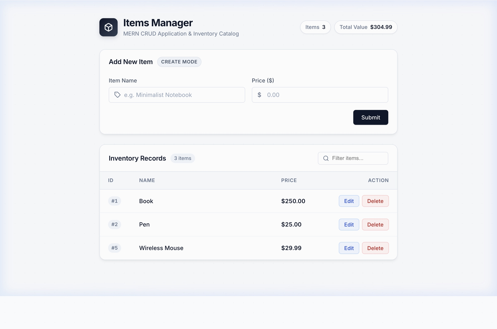

# MERN Lab Task 1 — Items Manager CRUD App

A hardened REST API-backed CRUD web app built with **Express.js**, **modern vanilla HTML/CSS/JS**, and atomic JSON file persistence.

## Screenshot



## Features

- **Create** — Add new inventory items with name and price validation
- **Read** — View all items in a live-updating, formatted data table
- **Update** — Edit any item with dedicated edit mode indicators and auto-focus
- **Delete** — Remove items safely with confirmation prompt
- **Live Search & Filter** — Instant client-side item filtering by name
- **Real-time Inventory Stats** — Live badges tracking total item count and valuation
- **Validation** — Client-side and server-side validation (empty name, negative price, price > 10M, XSS-safe input handling)
- **Persistence** — Data reliably stored in `items.json` using atomic temporary file writes
- **Double-click Protection** — Buttons disabled while network requests are in flight
- **Error Handling & Notifications** — Responsive alert banners with animated slide-in feedback for network or validation errors

## Project Structure

```
crud-app/
├── server.js          ← Express REST API & static file server
├── package.json       ← Node.js dependencies & scripts
├── items.json         ← Auto-created persistent storage
├── test-suite.js      ← Automated API verification test suite
├── screenshot.jpg     ← Application preview screenshot
└── public/            ← Frontend client assets
    ├── index.html     ← Modern semantic UI markup
    ├── style.css      ← Modern responsive styles & design tokens
    ├── script.js      ← Client logic, Fetch API, live filter & state
    └── screenshot.jpg
```

## Setup & Run

### 1. Install dependencies
```bash
npm install
```

### 2. Start the server
```bash
node server.js
```
*Or run in watch mode during development:*
```bash
npm run dev
```

### 3. Open in Browser
Navigate to **http://localhost:3000** in your browser.

## Running Tests

Run the automated test checklist against the active server:
```bash
node test-suite.js
```

## REST API Reference

| Method | Endpoint         | Description                   |
|--------|------------------|-------------------------------|
| `GET`    | `/api/items`     | Fetch all items               |
| `POST`   | `/api/items`     | Create a new item             |
| `PUT`    | `/api/items/:id` | Update an existing item by ID |
| `DELETE` | `/api/items/:id` | Delete an item by ID          |

Every error response adheres to the JSON shape: `{ "message": "reason" }`.

## Tech Stack

- **Backend:** Node.js, Express.js
- **Frontend:** Vanilla HTML5, CSS3 (Modern Flexbox/Grid, CSS variables), JavaScript (Fetch API)
- **Typography:** Inter font family via Google Fonts
- **Storage:** JSON file (`items.json`) with atomic replace writes
